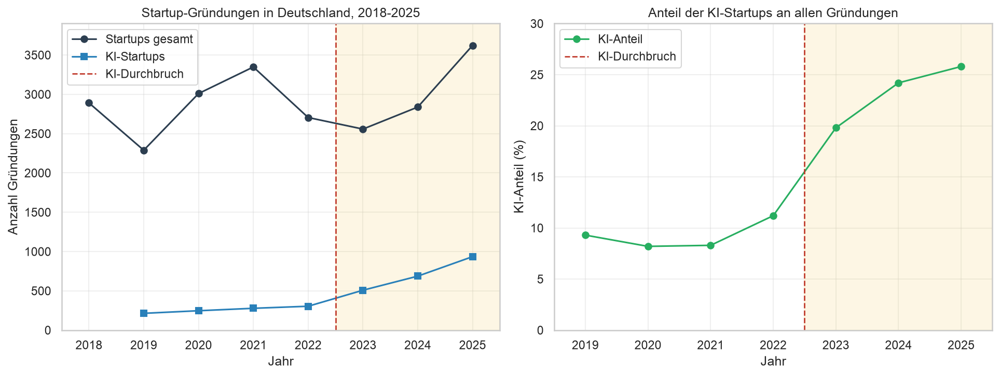
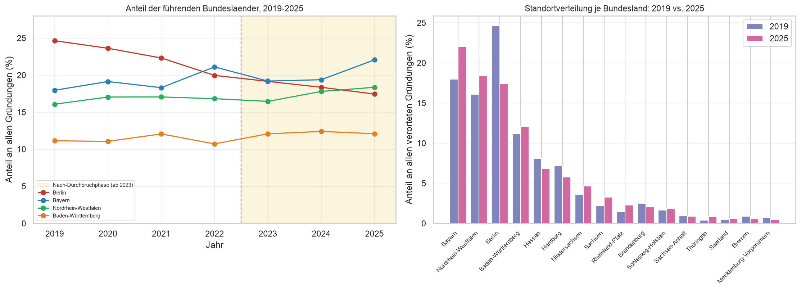
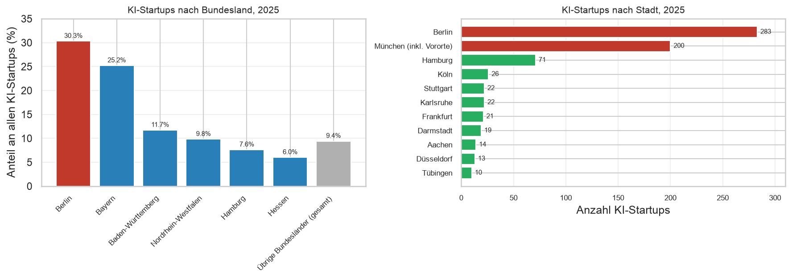

# KI-Aufkommen und Startup-Gründungen in Deutschland (2018–2025)

Datenanalyse zur Frage, ob der KI-Durchbruch (Veröffentlichung von ChatGPT Ende 2022) die Zahl und die Standorte von Startup-Gründungen in Deutschland verändert hat.

Gruppenprojekt im Modul **Data Science** an der HTW Berlin (SoSe 2026).

## Mein Beitrag

Ich habe die Kapitel **2 (KI-Aufkommen und Gründungsdynamik)** und **3 (Räumliche Verschiebung der Gründungsstandorte)** bearbeitet:

- Datenzugriff auf eine PostgreSQL-Datenbank per Python (SQLAlchemy, psycopg2), inklusive Lösung eines Encoding-Problems (`SQL_ASCII`-Server, UTF-8-Daten)
- Datenaufbereitung und Analyse mit pandas: Wachstumsraten, Vorher-/Nachher-Vergleich, Korrelationen
- Konzentrationsmaße für die Standortanalyse: Anteile, CR4, Herfindahl-Hirschman-Index
- Visualisierung mit matplotlib und seaborn sowie Interpretation der Ergebnisse

## Fragestellungen

- **H1:** Stieg mit dem Aufkommen von KI die Zahl der Startup-Gründungen pro Jahr in Deutschland?
- **H2:** Wie haben sich die geografischen Standorte von Startup-Gründungen im Zeitverlauf verändert?

## Wichtigste Ergebnisse

**H1 – Gründungsdynamik**

- Die **Gesamtzahl** der Gründungen schwankt stark (−20,8 % bis +31,5 % pro Jahr) und zeigt keinen Sprung nach dem KI-Durchbruch (Pearson r = 0,40; Mittelwert nur +5,5 %).
- Die Zahl der **KI-Startups** steigt dagegen fast durchgehend von 214 (2019) auf 935 (2025) (r = 0,93), mit einem Sprung von +67,1 % von 2022 auf 2023.
- Der **KI-Anteil** an allen Gründungen wächst von rund 8–9 % auf 25,8 %.
- **Fazit:** H1 gilt für KI-Startups, nicht aber für alle Gründungen.



**H2 – Standorte**

- Berlins Anteil an allen Gründungen sinkt von 24,6 % (2019) auf 17,4 % (2025). Berlin fällt von Platz 1 auf Platz 3, hinter Bayern und Nordrhein-Westfalen.
- Bundesweit wachsen die Gründungen um 58 %, Berlin nur um 12 %, Bayern dagegen um 94 %.
- Bei **KI-Startups** bleibt Berlin klar führend (30,3 %). Berlin und München zusammen stellen rund die Hälfte aller KI-Startups.
- **Fazit:** Gründungen insgesamt verteilen sich stärker auf die Flächenländer, KI-Gründungen bleiben in wenigen Metropolen konzentriert.




## Daten

- Startup-Gründungen gesamt und nach Bundesland: [Startupdetector](https://startupdetector.de), jährliche Reports 2018–2025
- KI-Startups: [appliedAI Institute for Europe](https://www.appliedai-institute.de), „AI Startup Landscape" 2019–2025

Die Daten lagen in einer gemeinsamen PostgreSQL-Datenbank der Hochschule. Diese ist nicht öffentlich zugänglich, daher sind die Daten nicht in diesem Repository enthalten. Die Ergebnisse und Abbildungen sind im Notebook sichtbar.

## Tools

Python · pandas · NumPy · matplotlib · seaborn · SQLAlchemy · PostgreSQL · Jupyter

## Ausführen

```bash
pip install -r requirements.txt
export DB_HOST=... DB_NAME=... DB_USER=...
jupyter lab KI_Startups_Analyse.ipynb
```

Das Passwort wird beim Ausführen abgefragt und nicht gespeichert.
